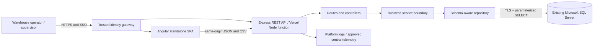

# Enterprise Architecture

## Layers

1. **Angular SPA:** standalone and lazy-loaded feature routes; typed API client; reactive loading/error/empty states; responsive navigation, filters, tables, paging and details. UI state is never an authorization boundary.
2. **Enterprise gateway:** authenticates users, strips untrusted incoming copies of identity headers, adds trusted identity and role assertions, applies rate limits and forwards only allowed traffic. This is a required deployment component, not included or simulated.
3. **Express routes/controllers:** validate request shape, enforce role gates, return consistent status/error envelopes, and write minimal timing/status logs without row values or query strings.
4. **Business services:** application boundary for verified workflow policy. Current services are read-only; status writes and unavailable reports are explicit 501s.
5. **Repository/schema adapter:** reads live SQL metadata; fails closed for ambiguous primary table matches; quotes discovered identifiers; binds all user values; uses a bounded connection pool and execution timeouts.
6. **Existing SQL Server:** only a pre-existing DB is accessed. No DDL is packaged. Deploy with a least-privilege read-only account.

## Decisions and limits

- Collection pagination is offset/page-based, one-indexed and capped at 100 to support operator page navigation. For very large tables, consider keyset pagination only after UX and schema key ordering are verified.
- Inventory is capped at 500 rows. It requires keyset pagination or additional paging for larger operational datasets.
- Search wildcard characters are escaped; filter values are SQL parameters. Sort expressions are selected from a fixed API allowlist and discovered metadata.
- Dashboard definitions include explicit provisional heuristics; confirm status words and low-stock threshold before KPI signoff.
- CSV exports are limited to the first 100 matching records per request, role gated and disabled by default.
- Vercel serverless can only be used if SQL connectivity and egress are approved. Private SQL should not be exposed publicly for convenience.
- A write feature needs an existing concurrency token (such as a verified rowversion) or another approved transaction-based conditional update. The app will not create one.
