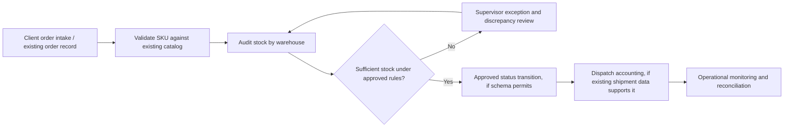
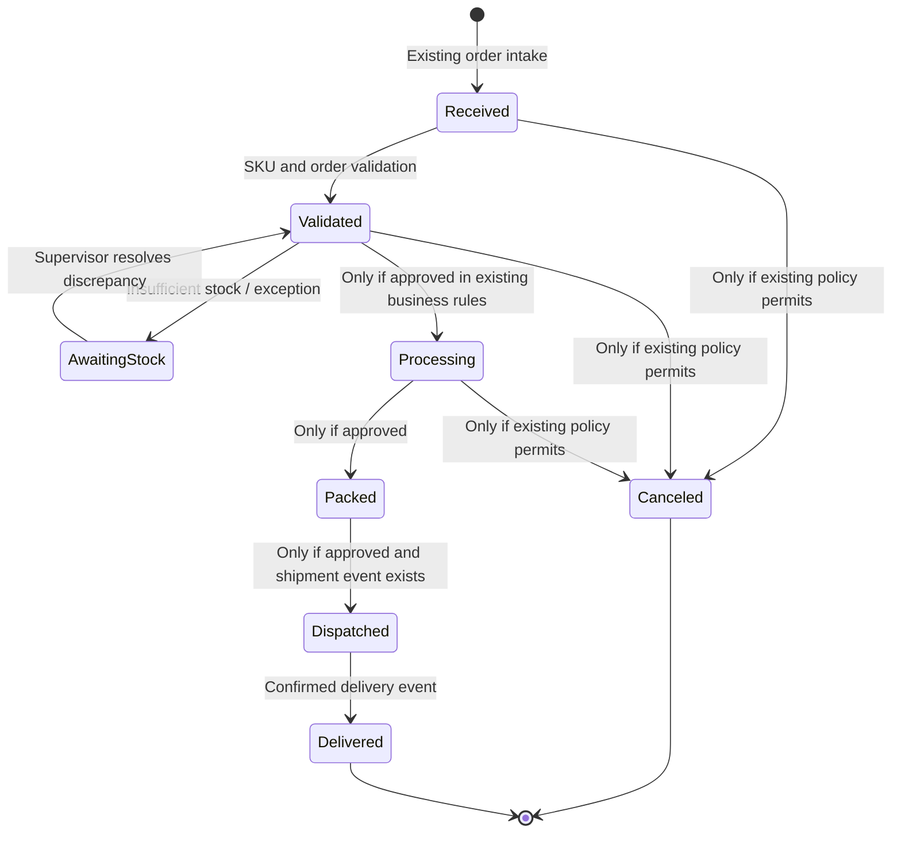

# Fulfillment Process, Lifecycle and RBAC

## Single-page workflow process diagram

This is a process guide, not a mutation implementation. The app does not intake orders, reserve stock, dispatch, or change status. “Available” is computed only as on-hand minus a discovered reserved field; the app does not infer reservations from order statuses.

## Status lifecycle state machine

**Illustrative only—not an authorized list of valid database states.** These labels are not persisted or accepted by the API. The implementation cannot allow `Canceled → Delivered` because all status writes are disabled. Confirm whether existing DB constraints or audit mechanisms enforce this invariant before enabling writes.

## Role capability / permissions matrix

| Capability | Senior Warehouse Operator | Senior Warehouse Supervisor | Senior System Administrator |
|---|---:|---:|---:|
| Read products, stock, orders and dashboard | Yes, after gateway authentication | Yes | Yes |
| Filter and page lists | Yes | Yes | Yes |
| CSV export | Optional; disabled by default | Optional; disabled by default | Optional; disabled by default |
| Resolve exceptions / authorize status writes | No write endpoint | Not enabled; requires approval | Not a DB privilege; external governance only |
| Manage user roles | No | No | Via identity/gateway governance outside this app |
| Change DB schema or credentials | No | No | Outside app; DBA/secret-manager process only |

The app trusts role claims only after a trusted gateway assertion. It does not itself provide SSO, role provisioning, access scoping, or database administration. System administrator does not imply unrestricted order/customer data access or SQL Server write rights.
